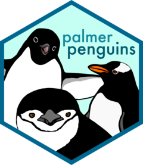
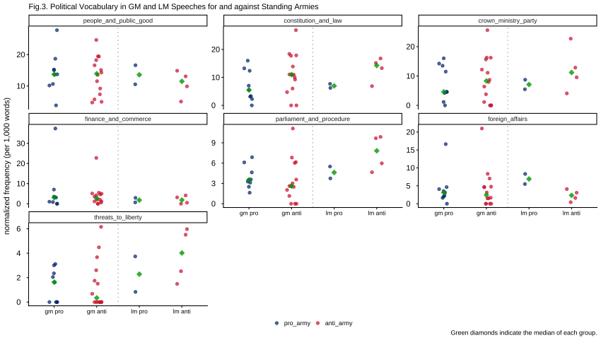
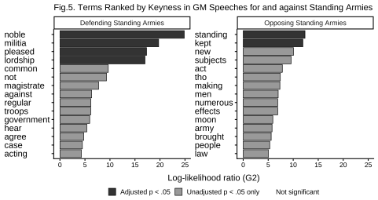

```{r}
#| label: setup
#| echo: false
#| output: false
#| include: false

source("../../_setup.R")

## reveal.js
library(deckroadmap)
library(countdown)
library(qrcode)

```


# 自己紹介{data-transition="slide" data-transition-speed="slow" data-roadmap="自己紹介"}

```{r}
#| label: roadmap
#| echo: false

use_roadmap(

  c("自己紹介", "設定の共有と管理","便利なplugin", "参考文献"),
  style = "progress",
  bottom = "20px",
  active_bg_color = "#C62828"
)

```


## 自己紹介

::::{.columns}
:::{.column width=70%}

### 専門：政治思想史
- 18世紀イギリスの議会政治：レトリック受容と新興メディア
  - 古典古代の思想（キケロやタキトゥス）の受容
  - 総合雑誌の偽装ディベート
- 量的テキスト分析を読み解きの補助として利用
  - [quanteda](https://quanteda.io/index.html)

### Rに関わる講義

- [RとQuartoではじめるデータサイエンス](https://kariyach.github.io/teaching/RandQuarto/index.html)
  - [palmer penguins](https://allisonhorst.github.io/palmerpenguins/)
  - 統計センター [SSDSE（教育用標準データセット）](https://www.nstac.go.jp/use/literacy/ssdse/)

:::{.callout-note appearance="simple"}
[「RやPython利用者向け」SSDSEの公開開始](https://www.nstac.go.jp/use/literacy/ssdse/single-byte/?doing_wp_cron=1794271158.3436229228973388671875)（2026年6月30日）
:::


::::

:::{.column width=30%}

{fig-align="center" width=70%}

{fig-align="center" width=60%}

::::
::::


## quantedaを使った記述統計

{fig-align="center"}

## quantedaを使った推測統計

{fig-align="center"}

# 設定の共有と管理{data-transition="slide" data-transition-speed="slow" data-roadmap="設定の共有と管理"}

## 設定の共有と管理

### reveal.js

- Quartoでスライドを作成するための出力フォーマット（JavaScriptベース）

:::{.callout-tip appearance="simple"}
reveal.jsを例に説明しますが、出力フォーマットのhtmlも、同じ問題を抱えており、同様の解決策が役立ちます
:::

#### 利点
- Rのコードを実行し、その結果（表・グラフなど）をスライドに表示できる
  - 画像のコピペは不要
- スライドのデザインやレイアウトを柔軟にカスタマイズできる
- プラグインによって機能を拡張できる

#### 参照
- [公式サイト](https://quarto.org/docs/presentations/revealjs/)
- 「[Quartoで、コピペミスしないプレゼンテーション資料作成](https://ito4303.github.io/KanazawaR005/quarto-presentation.html#/title-slide)」（Kanazawa.R #5）

## 設定の共有と管理 > 問題

### 前提

- 複数のスライドファイルを作成する必要がある
  - 授業教材；学会報告
- スライドごとにコンテンツは異なるが、基本的な体裁・デザイン・設定は共通
  - 共通点：氏名や所属、メールアドレスなどの基本情報
  - 相違点：タイトル、日付など

### 問題

- 設定に関わるコードが多く、かつ複雑になる
  - 必要なコードがしっかりと目に入るようにしたい
- 体裁や設定を変更する場合、すべてのファイルの該当箇所を個別に修正する必要がある

## 設定の共有と管理 > 解決策

### 解決策

- 設定・コードの外部ファイル化と共有（@HuangC:2023webpage）
  - YAMLフロントマター：`metadata-files`
  - Setupチャンク：`source("../../_setup.R")`

:::{.callout-tip appearance="simple"}
reveal.jsの話題から逸れますが、setupチャンクでも同様のことが可能です
:::

:::{.callout-note appearance="simple"}
生成AIは知りたいことを教えてくれることが多いですが、ネット検索には、思いがけない情報やアイデアとの「偶然の出会い」があります（芋づる式に発見がある）
:::


## 設定の共有と管理 > 解決策 > YAML フロントマター

::::{.columns}
:::{.column width=45%}

### YAMLフロントマターに直接記述

```
---
title: "Quartoで作るreveal.jsスライドのTips"
subtitle: "Kanazawa.R #6"

author:
  - name: 苅谷千尋
    orcid: 0009-0008-3085-947X
    email: kariyach@staff.kanazawa-u.ac.jp
    affiliations: 金沢大学

date-format: long

format: 
  revealjs: 
    theme: 
      - default
      - ../../slide.scss
    width: 1280
    height: 720
    center-title-slide: true
    # view: 'scroll'
    # scrollLayout: 'compact'
    menu:
      side: left
      width: wide
      numbers: true
    toc: true
    toc-depth: 1
    toc-title: "目次"
    slide-number: h.v
    # slide-number: c/t
    code-copy: true
    preview-links: false
    link-external-newwindow: true
    link-external-icon: true
    # show-slide-number: print
    # embed-resources: true
    # self-contained: true
    progress: true
    history: true
    keyboard: true
    # transition: slide
    background-transition: fade
    navigation-mode: vertical
    controls-layout: bottom-right
    controls-tutorial: true
    # chalkboard:
    #   buttons: false
    # lang: ja
    # slide-tone: true
    # pdfSeparateFragments: true
    # mouse-wheel: true
    # touch: true
    # center: true
    verticator:
     # themetag: 'h1'
      color: '#C62828'
      inversecolor: ''
      skipuncounted: false
      clickable: true
      position: 'auto'
      offset: '3vmin'
      autogenerate: true
      tooltip: false
      scale: 1

revealjs-plugins:
  - pointer
  - confetti
  - multimodal
  - verticator
  - chat-bubbles

filters: 
  - timer
  - sticky-notes

revealjs-config:
    jumpToSlide: true
    scrollProgress: true
    keyboard:
        # カスタムバインディング
      "67": null  # デフォルトの 'c' キーを無効化
      "88": "toggleChalkboard"  # 'x' キーを chalkboard のトグルに割り当て
      "90": "startConfetti"    # 'z' キーを confetti のトグルに割り当て

title-slide-attributes:
    data-background-image: img/logo.png
    # data-background-opacity: "0.5"
    data-background-size: 10%
    data-background-position: 90% 90%
    # data-background-position: 5% 5%
    data-roadmap: "none"

# code-line-numbers: true

# References
bibliography: /Users////.json
csl: /Users////..csl
citations-hover: true

# Exclude from search indexing
include-in-header:
  text: |
    <meta name="robots" content="noindex, nofollow">

```

::::

:::{.column width=10%}

　
　
　
　
　
　
　
　
　
　
　
　
　
　
　

⇒
::::

:::{.column width=45%}

### 外部ファイルで一元管理

```
---
title: "Quartoで作るreveal.jsスライドのTips"
subtitle: "Kanazawa.R #6"

format: revealjs

date: 28, Nov 2026

metadata-files:
  - ../../_slides.yml

title-slide-attributes:
    data-background-image: img/Jan_Vermeer_The_Art_of_Painting.webp
    data-background-size: 15%
    data-background-position: 90% 90%

```


::::
::::

1. タイトル類を除くすべてのコードをコピーして、「_slides.yml」名で保存
2. `metadata-files:`でファイルを読み込み

<!-- :::{.callout-note appearance="simple"} -->

<!-- - 共通する設定：_slides.yml に記述 -->
<!-- - スライドごとに異なる設定（タイトル、日付、画像など）：YAMLフロントマターに記述 -->

<!-- ::: -->

## 設定の共有と管理 > setupチャンク

::::{.columns}
:::{.column width=47%}

### Setupチャンクに直接記入

```{r}
#| echo: true
#| output: false

# load package -----
library(tidyverse)

## Font settings for plots
library(sysfonts)
library(showtext)

## colour palette
library(paletteer)

# ggplot theme_classic font settings ----
ggplot2::theme_set(
  theme_classic(base_family = "jp") +
    theme_sub_axis_bottom(
      title = element_text(size = 11, margin = margin(t = 8)),
      text  = element_text(size = 10)
    ) +
    theme_sub_axis_left(
      title = element_text(size = 11, margin = margin(r = 8)),
      text  = element_text(size = 10, hjust = 0)
    ) +
    theme_sub_legend(
      position   = "bottom",
      margin     = margin(t = -4),
      key.size   = unit(6, "mm")
    ) +
    theme_sub_plot(
      title   = element_text(size = 10),
      caption = element_text(size = 10)
    )
)

# Japanese font for Mac ----
font_add(
  "jp",
  "/System/Library/Fonts/ヒラギノ角ゴシック W5.ttc"
)

showtext_auto()

```


::::

:::{.column width=5%}

　
　
　
　
　

⇒
::::

:::{.column width=48%}

### 外部ファイルで直接管理

```{r}
#| echo: true
#| output: false
#| code-line-numbers: "1"

source("../../_setup.R") # 外部ファイルをロード

# load additional packages ----
## reveal.js
library(deckroadmap)
library(countdown)
library(qrcode)

```


1. 左のコードをすべてコピーして「_setup.R」名で保存
2. setupチャンクにsource()関数を挿入して「_setup.R」をロード

:::{.callout-note appearance="simple"}
チャンクオプションに`#| file: ../../_setup.R` と指定する方法もあります。しかし、この方法では外部ファイルのコードだけが実行されるため、パッケージの追加など、別の処理を同じチャンクに記述することはできません
:::

::::
::::

## 確認（サンプルコード）

::: {.panel-tabset}

### Code

```{r}
#| echo: true
#| output: false

penguins |>
  drop_na(species, sex, body_mass) |> 
  group_by(species, sex) |>
  summarise(avg_body_mass = mean(body_mass), .groups = "drop") |> 
  ggplot(aes(x = species, y = avg_body_mass, fill = species)) +
  geom_col() + 
  facet_wrap(~ sex) +
  scale_fill_paletteer_d("khroma::highcontrast") +
  labs(title = "タイトル",
       caption = "キャプション")

```


### Plot

```{r}
#| fig-width: 10
#| fig-height: 6
#| fig-align: center

penguins |>
  drop_na(species, sex, body_mass) |> 
  group_by(species, sex) |>
  summarise(avg_body_mass = mean(body_mass), .groups = "drop") |> 
  ggplot(aes(x = species, y = avg_body_mass, fill = species)) +
  geom_col() + 
  facet_wrap(~ sex) +
  scale_fill_paletteer_d("khroma::highcontrast") +
  labs(title = "タイトル",
       caption = "キャプション")

```

:::

# 便利なplugin{data-transition="slide" data-transition-speed="slow" data-roadmap="便利なplugin"}

## 便利なplugin

### quarto-reveal.jsのみ

- [deckroadmap](https://github.com/CodingTigerTang/deckroadmap)
- [quarto-revealjs-chat-bubbles](https://github.com/EmilHvitfeldt/quarto-revealjs-chat-bubbles)
- [reveal.js-plugin-spotlight](https://github.com/denniskniep/reveal.js-plugin-spotlight)

### quarto-html/quarto-reveal.jsのどちらにも対応
- [quarto-qrcode](https://github.com/jmbuhr/quarto-qrcode)
- [countdown](https://github.com/gadenbuie/countdown/tree/main)

## deckroadmap

- deckroadmap
  1. ロードマップに表示する見出しを指定する
  2. 第1見出し行に data-roadmap を指定

```{r}
#| echo: true
#| output: false

use_roadmap(
  c("自己紹介", "設定の共有と管理","便利なplugin", "参考文献"),
  style = "progress",
  bottom = "20px",
  active_bg_color = "#C62828"
)

```

```
# 自己紹介{data-roadmap="自己紹介"}
## コンテンツ
## コンテンツ
# 設定の共有と管理{data-roadmap="設定の共有と管理"}
## コンテンツ
## コンテンツ
```

## chat-bubbles > レンダー

### 受講生の心理的安全性

::: {.chat}

::: {.speaker-1}
この本、面白かったよ
:::

[💯]{.fragment .reaction}
[👍]{.fragment .reaction}
[☺️]{.fragment .reaction}

::: {.fragment .speaker-2}
それって中学生が読む本じゃないの？恥ずかしくないのかな？🤭
:::

::: {.fragment .speaker-1}
🤮🤮🤮🤮🤮🤮
:::

::: {.fragment .speaker-1}
🤔（この人、大丈夫かな、頭）
:::


::: {.fragment .speaker-3}
本に年齢制限でもあるの？ 面白いと思ったなら、それでいいじゃん
:::

::: {.fragment .speaker-1}
（ありがとう🥳）
:::

:::

## chat-bubbles > コード

```
::: {.chat}

::: {.speaker-1}
この本、面白かったよ
:::

[💯]{.fragment .reaction}
[👍]{.fragment .reaction}
[☺️]{.fragment .reaction}

::: {.fragment .speaker-2}
それって中学生が読む本じゃないの？恥ずかしくないのかな？🤭
:::

::: {.fragment .speaker-1}
🤮🤮🤮🤮🤮🤮
:::

::: {.fragment .speaker-1}
🤔（この人、大丈夫かな、頭）
:::


::: {.fragment .speaker-3}
本に年齢制限でもあるの？ 面白いと思ったなら、それでいいじゃん
:::

::: {.fragment .speaker-1}
（ありがとう🥳）
:::

:::

```

## spotlight

> あのイーハトーヴォのすきとおった風、夏でも底に冷たさをもつ青いそら、うつくしい森で飾られたモリーオ市、郊外のぎらぎらひかる草の波。またそのなかでいっしょになったたくさんのひとたち、ファゼーロとロザーロ、羊飼のミーロや、顔の赤いこどもたち、地主のテーモ、山猫博士のボーガント・デストゥパーゴなど、いまこの暗い巨きな石の建物のなかで考えていると、みんなむかし風のなつかしい青い幻燈のように思われます。では、わたくしはいつかの小さなみだしをつけながら、しずかにあの年のイーハトーヴォの五月から十月までを書きつけましょう。


## countdown

- countdown

```{r}
#| echo: true
#| output: false

countdown(
  minutes = 20,
  seconds = 0,
  top = "75%",
  left = "60%",
  font_size = "4em",
  warn_when = 30,
  blink_colon = TRUE,
  play_sound = TRUE
)

```


```{r}

countdown(
  minutes = 20,
  seconds = 0,
  top = "75%",
  left = "60%",
  font_size = "4em",
  warn_when = 30,
  blink_colon = TRUE,
  play_sound = TRUE
)

```

## QRコード

::::{.columns}
:::{.column width=50%}


```{r}
#| echo: true
#| output: false

code <- qr_code("https://kanazawar.connpass.com")

plot(code)

```

::::

:::{.column width=50%}

```{r}
#| align: center

code <- qr_code("https://kanazawar.connpass.com")

plot(code)

```

::::
::::


# 参考文献{data-transition="slide" data-transition-speed="slow" data-roadmap="参考文献"}


## 参考文献

